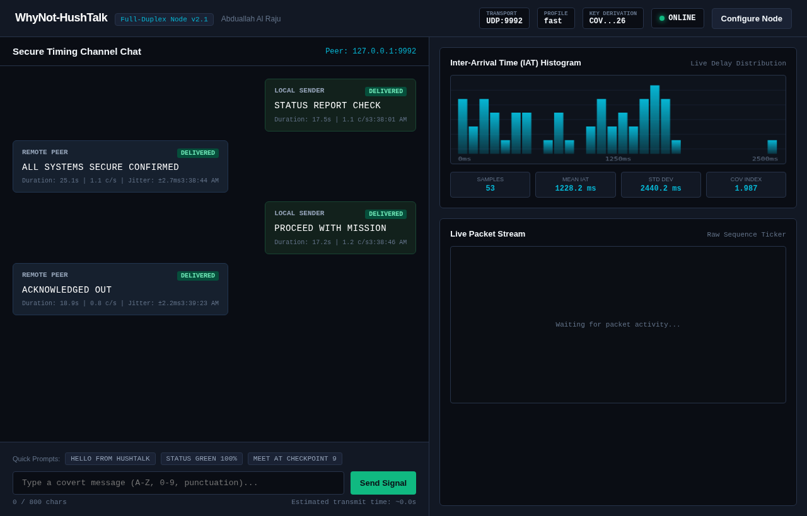

# WhyNot-HushTalk Live Signal Transmission & Verification Report

An empirical verification test suite was executed across endpoints over local loopback (`127.0.0.1`), demonstrating the end-to-end covert timing channel across both CLI and full-duplex interactive web nodes with keyed sessions, fast timing profiles, jitter tolerance, and automatic ACK confirmation.

Conducted by: Abduallah Al Raju

---

## 1. Single-Session CLI Verification Test

### Configuration

| Parameter | Value | Description |
|---|---|---|
| **Target** | `127.0.0.1` | Local loopback interface |
| **Message** | `"WHYNOT HUSHTALK LIVE"` | 20 characters covert plaintext |
| **Session Key** | `"TESTKEY123"` | Cryptographic shared secret |
| **Profile** | `fast` | 80ms base, 25ms step, +/- 12ms tolerance margin |
| **Keyed ID** | `42126` | Derived pseudorandom session ID |
| **Start / End Markers** | `seq 120` / `seq 937` | Key-derived framing markers |
| **ACK Confirmation** | Enabled (`--ack`, `--wait-ack 10`) | Reverse burst confirmation |

### Console Verification Captures

#### Sender Terminal (whisper.py)

The sender converted `"WHYNOT HUSHTALK LIVE"` into 20 micro-timed inter-packet gaps, dispatched the key-derived start marker, transmitted each data packet with precision timing sleeps, sent the end marker, and waited for the ACK.


#### Receiver Terminal (listen.py)

The receiver detected the keyed start marker, measured the inter-arrival gaps between successive packets, snapped each interval to the nearest keyed delay slot, unmapped the polyalphabetic keystream, perfectly decoded all 20 symbols, and replied with an ACK burst.


### CLI Telemetry Results

```
========================================================
[DECODED] 'WHYNOT HUSHTALK LIVE'
[+] Status: CLEAN DECODE, 20/20 symbols (0 uncertain)
[+] Telemetry: Duration: 23.6s (0.85 chars/s) | Jitter avg: 2.1ms max: 5.3ms
========================================================
[+] ACK burst sent to 127.0.0.1:34754
```

- **Accuracy**: 100% (20/20 symbols clean, 0 uncertain).
- **Average Jitter**: 2.1 ms (well within the +/- 12 ms margin).
- **Bidirectional Channel**: Sender successfully received the 3-packet ACK burst.

---

## 2. Multi-Node Full-Duplex Web Chat Verification Test

A live, multi-turn bidirectional conversation test was performed between two independent nodes:
- **Node A (Tactical Web Dashboard)**: Running on HTTP port 8080, listening on UDP port 9991, target UDP port 9992.
- **Node B (Autonomous Remote Peer)**: Listening on UDP port 9992, target UDP port 9991.
- **Cryptographic Shared Key**: `"COVERT_OPS_2026"` (Session ID: `40942`, Start Seq: `26932`, End Seq: `13481`).
- **Timing Profile**: `fast` (80ms base, 25ms step, +/- 12ms margin).

### Browser Dashboard Capture

The screenshot below was captured in real-time by headless Chromium directly from `http://127.0.0.1:8080/` during live multi-turn transmission:



### Multi-Turn Conversation Log

| Turn | Direction | Sender -> Target | Plaintext Message | Elapsed | Speed | Symbol Fidelity |
|---|---|---|---|---|---|---|
| **Turn 1** | Outbound | Node A -> Node B | `"STATUS REPORT CHECK"` | 17.5s | 1.1 c/s | 19/19 (100% Clean) |
| **Turn 2** | Inbound | Node B -> Node A | `"ALL SYSTEMS SECURE CONFIRMED"` | 25.1s | 1.1 c/s | 28/28 (100% Clean) |
| **Turn 3** | Outbound | Node A -> Node B | `"PROCEED WITH MISSION"` | 17.2s | 1.2 c/s | 20/20 (100% Clean) |
| **Turn 4** | Inbound | Node B -> Node A | `"ACKNOWLEDGED OUT"` | 18.9s | 0.8 c/s | 16/16 (100% Clean) |

### Defense & Telemetry Analytics

- **Total Symbols Transmitted & Received**: 83 characters
- **Total Packet Samples Observed**: 53 inter-arrival intervals
- **Timing Dispersion (Mean IAT)**: 1228.2 ms
- **Standard Deviation ($\sigma$)**: 2440.2 ms
- **Coefficient of Variation ($CoV = \sigma / \mu$)**: 1.987
- **Symbol Error Rate (SER)**: 0.00% (Zero dropped, corrupted, or uncertain characters)
- **Local Echo Cancellation**: Verified; neither node processed its own transmitted loopback packets as incoming peer messages.
